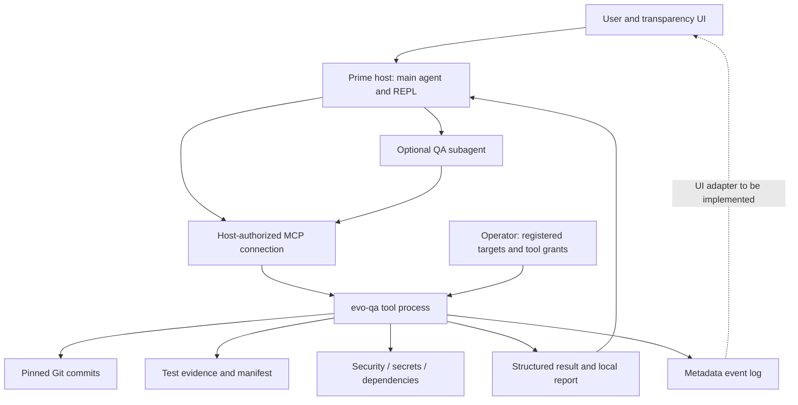

# QA tools for the Prime harness

## Ownership

Prime owns the main agent, recursive subagents, messages, scheduling, memory,
and workflow selection. This package owns deterministic QA tools and evidence.
It creates no agents and makes no model calls. The model can use only the Python
REPL as its top-level tool while accessing QA through the REPL's MCP client.



## Three tools

| Tool | Input | Result | Authority |
|---|---|---|---|
| qa_inspect | target_id | Commit IDs, changed files, risk classification | Registered repository read |
| qa_scan | target_id | Scanner results and limitations; never approval | Read + fixed scanner execution |
| qa_review | target_id | Evidence-validated QA recommendation | Read + scanner + registered Test evidence |

The caller cannot select a filesystem path, shell command, policy, output
directory, or human approval. It selects an opaque registered target ID. The
operator configuration grants tools per service instance. Create separate
service instances/connections for different capability sets. This version does
not authenticate a different caller identity on each request.

Scan does not require Test evidence, so the main agent can call it at any point.
Full review requires the original checksummed Test bundle plus registered spec
and profile hashes. Do not fabricate a Test handoff to satisfy this requirement.
An adapter for Mihir's stored workflow artifacts remains separate integration
work: those artifacts do not implement the old Test evidence contract.

## Operator setup

Use a separate environment from Test, since both legacy packages are named `app`.

```bash
cd qa-agent-prototype
python -m pip install -e '.[prime]'
```

Store an operator-owned JSON file outside the reviewed repository:

```json
{
  "schema_version": "1.0",
  "output_dir": "/absolute/operator/qa-results",
  "allowed_tools": ["qa_inspect", "qa_scan", "qa_review"],
  "targets": {
    "pr-7": {
      "repo": "/absolute/registered/repository",
      "head_ref": "pr",
      "base_sha": "<40-character base commit>",
      "head_sha": "<40-character reviewed head>",
      "verification": "/absolute/test/artifacts/verification.json",
      "spec_hash": "<approved spec hash>",
      "test_profile_hash": "<approved profile hash>"
    }
  }
}
```

Replace placeholders with trusted recorded values. For scan-only use, omit
verification/spec/profile fields and grant only qa_inspect and qa_scan.
The evidence manifest and all referenced artifacts must accompany verification.
The operator registers a fresh target after commits, spec, or test profile change.

Configure Prime's `evo-qa` stdio MCP connection to run the environment's Python
with arguments `-m app.prime_mcp`, package directory as cwd, and
`EVO_QA_CONFIG=/absolute/operator/qa-config.json` in the server environment.
The installed `evo-qa-tools` entry point is equivalent.

Inside Prime's REPL, after connection setup:

```python
from rlm import mcp
inspection = await mcp.call_tool("evo-qa", "qa_inspect", {"target_id": "pr-7"})
scan = await mcp.call_tool("evo-qa", "qa_scan", {"target_id": "pr-7"})
# Optional when valid Test evidence has been registered:
review = await mcp.call_tool("evo-qa", "qa_review", {"target_id": "pr-7"})
```

These are REPL client examples, not a new agent framework. The server is tested
over actual stdio MCP; a live Prime model/session has not been exercised here.

## Permissions and governance

The server enforces its configured tool and target allowlists at the API boundary.
Only registered commits are scanned. Changed head references return STALE; checks
that cannot execute cannot be treated as passing. QA policy is operator supplied,
and upstream human confirmation remains binding. No tool merges, publishes,
changes policy, spawns agents, or promotes memory/skills.

This is NOT an OS sandbox. A same-user unrestricted REPL could bypass these tools
or alter their files. Deploy the tool service with a separate OS identity/container
and read-only repository/evidence mounts if that threat is in scope; permit writes
only to its temporary and report directories. Review targets must be trusted local
Git mirrors, including their Git config. Configuration placement alone is not
access control. Evidence checksums detect corruption, not a coordinated forgery.

Policy changes, grants, and human approval must remain outside model-controlled
memory refinement. Evaluate candidate prompts/skills against frozen QA cases,
compare regressions, require promotion authority, and retain rollback history.
This package supplies regression cases; it does not implement an evolution loop.

## Transparency contract

Every call has a call_id. `events.jsonl` records started/completed/error/denied
events, timestamps, tool, and target ID. Unauthorized target names and exception
bodies are not logged. Completed scans/reviews are saved under `<call_id>/tool_result.json`;
early STALE/BLOCKED responses are returned directly and have audit events only.
Full reviews also write qa_decision.json and qa_report.md. Results redact matched
secrets through the existing scanner; this is not a universal secret-redaction system.

The UI should display parent/child agent IDs from Prime, tool call IDs, commit IDs,
check status, findings, duration, limitations and approval requests. Bind the host's
agent identity to call IDs there; this service does not invent agent attribution.
Show observable actions and supplied explanations, not claims of hidden reasoning.

## Options and tradeoffs

| Approach | Benefits | Costs/limits |
|---|---|---|
| Existing standalone QA CLI | Already tested; simple offline demo | Fixed file handoff; manual orchestration |
| Direct Python imports in the agent REPL | Smallest adapter; simple structured returns | `app` namespace conflicts; model shares tool/policy process |
| Prime + isolated MCP QA service (implemented adapter) | Reuses scanners; aligns with Test; host can restrict connection capabilities | Needs operator registration and deployment boundaries; UI bridge still needed |
| Team-built RLM runtime | Full control of UI and workflows | Team owns lifecycle, permissions, messaging, evolution and integration maintenance |

RLM keeps large inputs in an external environment and supports programmatic
recursive calls. That can reduce repeated context, but token savings are workload
dependent; this QA update does not benchmark token efficiency.

Prime's Python `rlm` shim bridges recursive calls to the host; `repl.py` executes
persistent cells; `harness.py` stores supplemental memory, prompts, skills and
subagent specifications. The Python folder alone is not the whole host/runtime.

References inspected November 17, 2026 (upstream main can change):
- https://arxiv.org/abs/2512.24601
- https://github.com/PrimeIntellect-ai/prime-agent
- https://github.com/PrimeIntellect-ai/prime-agent/tree/main/prime-agent-runtime/src/rlm
- Team Test tools: shanqin at b20f9f3 (MCP + registered permissions)
- Team runtime: rlm-mihir at 11b93dd

## Verification

```bash
python -m pytest -q
python demo_acceptance.py
```

`tests/test_prime_tools.py` covers all eight existing scenarios through the tool
interface, scan without evidence, permission denial, evidence corruption, stale
heads, human approval retention, redaction, audit events and real MCP transport.
The MCP test skips without the optional prime extra. Two older integration tests
skip when the teammate prototypes are not present as siblings.
